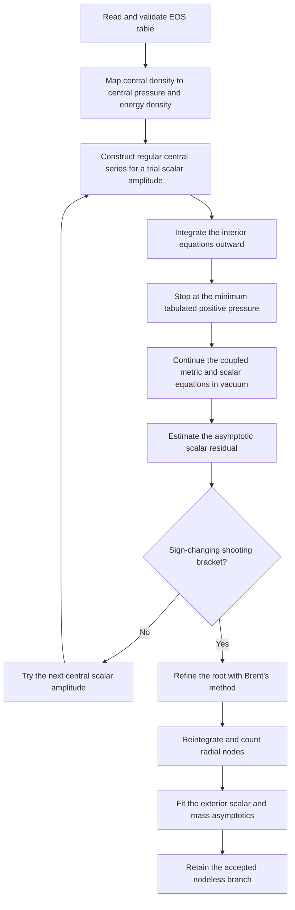

# Numerical Methods

This document describes the numerical procedure implemented in the repository for static, spherically symmetric neutron stars in the quadratic Ricci–Gauss–Bonnet scalar–tensor model. It is intended to make the mathematical reduction, boundary-value strategy, numerical algorithms, and principal numerical limitations transparent. It describes the current source tree; a saved `run_metadata.json` file records the settings requested for an individual run.

The implementation follows the model studied by Ventagli et al. (2021), with the conventions stated below. The code is an exploratory research solver: the regression tests are useful consistency checks, but they do not replace convergence studies or independent benchmark calculations.

The nonlinear stellar calculation follows this sequence:




## 1. Model, conventions, and units

The code uses the canonical scalar normalization

\[
S=\int d^4x\sqrt{-g}\left[\frac{R}{2\kappa}
-\frac12\nabla_\mu\phi_V\nabla^\mu\phi_V
-\frac{\beta_V}{4}R\phi_V^2
+\frac{\alpha}{2}\mathcal G\phi_V^2\right]
+S_m[g_{\mu\nu},\Psi_m],
\qquad \kappa=8\pi .
\]

Here \(\phi_V\) is dimensionless in the adopted geometrized convention, \(\beta_V\) is dimensionless, and \(\alpha\) has dimensions of length squared. The scalar equation is

\[
\Box\phi_V=\left(\frac{\beta_V}{2}R-\alpha\mathcal G\right)\phi_V .
\]

The matter sector is minimally coupled. The bare scalar mass and derivative coupling are set to zero. Thus, the code does **not** numerically explore arbitrary functions \(F(\phi)\), \(V(\phi)\), and \(f(\phi)\) from the general action; it solves this particular quadratic model.

For comparison with the thesis convention,

\[
\phi_{\rm thesis}=\sqrt{16\pi}\,\phi_V,
\qquad \beta_V=2\beta_{\rm thesis},
\qquad \eta=4\alpha .
\]

Consequently, a run with the code parameters \((\alpha,\beta_V)=(30\,{\rm km}^2,-10)\) corresponds to \((\eta,\beta_{\rm thesis})=(120\,{\rm km}^2,-5)\) in that convention. The scalar charge returned by the code is defined using \(\phi_V\); its coefficient in the thesis-field convention is larger by \(\sqrt{16\pi}\).

We use \(G=c=1\) and express radial coordinates and masses in kilometres. Energy density and pressure are converted to geometrized units of \({\rm km}^{-2}\); the conversion used is \(1\,{\rm MeV\,fm}^{-3}=1.323833\times10^{-6}\,{\rm km}^{-2}\) (with the CODATA value of the MeV and the adopted values of \(G\) and \(c\)). The tabulated column `rho_g_cm-3` is the total energy-equivalent density \(\epsilon/c^2\), not the baryonic rest-mass density.

## 2. Radial reduction and algebraic closure

The static, spherically symmetric metric is written as

\[
ds^2=-e^{\Gamma(r)}dt^2+e^{\Lambda(r)}dr^2+r^2d\Omega^2,
\]

where \(\Gamma=2\nu\) and \(\Lambda=2\lambda\) relative to the notation used in parts of the thesis. The numerical state vector is

\[
Y(r)=\left(\Gamma,U,\phi_V,\psi,p\right),
\qquad U=\Gamma',\qquad \psi=\phi_V'.
\]

The radial coordinate \(r\) is the independent variable. The energy density is supplied by the EOS as \(\epsilon=\epsilon(p)\). Matter conservation gives the pressure equation

\[
p'=-\frac12(\epsilon+p)U .
\]

A useful feature of this formulation is that \(\Lambda\) is **not** integrated as an independent variable. The \(rr\) field equation is rearranged into a quadratic equation for \(x=e^\Lambda\):

\[
4A x^2+2B x+C=0 .
\]

The coefficients \(A,B,C\) are algebraic functions of \(r,U,\phi_V,\psi,p\) and the two couplings. At every right-hand-side evaluation, the code evaluates the discriminant and selects the positive root connected continuously to the GR solution,

\[
x=\frac{-B+\sqrt{B^2-4AC}}{4A} .
\]

The evaluation is rejected if the discriminant is negative, the quadratic coefficient is numerically singular, or the selected root is non-positive. These checks prevent the integration from silently continuing on a non-real or non-physical metric branch.

Once \(x\) is known, the \(tt\) equation, the scalar equation, and the radial derivative of the algebraic \(rr\) constraint provide three linear relations for \(\Lambda'\), \(U'\), and \(\psi'\). In schematic form,

\[
\begin{pmatrix}
 t_\Lambda&0&t_\psi\\
 s_\Lambda&s_U&1\\
 c_\Lambda&c_U&c_\psi
\end{pmatrix}
\begin{pmatrix}\Lambda'\\U'\\\psi'\end{pmatrix}
=-\begin{pmatrix}t_0\\s_0\\c_0\end{pmatrix} .
\]

The entries depend on the local state, EOS values, and couplings. The resulting derivatives, together with \(\Gamma'=U\), \(\phi_V'=\psi\), and the pressure equation, form the five-dimensional first-order system integrated by the ODE solver.

The matrix has a sparse structure. The current implementation analytically eliminates \(\Lambda'\) and solves the remaining two-variable system by algebraic elimination. If an elimination coefficient or the reduced determinant is too small, or the result is non-finite, it falls back to `numpy.linalg.solve` on the full \(3\times3\) system. This is an implementation-level optimization; it does not change the equations being solved. Optional diagnostics evaluate both the original linear-system residual and the residual of the quadratic \(rr\) constraint.

## 3. Regular central initial data

The equations contain explicit inverse powers of \(r\), so numerical integration is not started at \(r=0\). Regularity and spherical symmetry require the first radial derivatives of the metric and scalar field to vanish at the centre. The fields are therefore expanded as

\[
\begin{aligned}
\Gamma(r)&=\Gamma_c+\Gamma_2r^2+O(r^4),\\
\Lambda(r)&=\Lambda_2r^2+O(r^4),\\
\phi_V(r)&=\phi_{Vc}+\phi_2r^2+O(r^4),\\
p(r)&=p_c-\frac12(\epsilon_c+p_c)\Gamma_2r^2+O(r^4).
\end{aligned}
\]

The additive constant \(\Gamma_c\) is fixed to zero as a time-coordinate normalization. The central pressure and energy density are obtained from the chosen central density and the EOS. Substituting the expansions into the field equations gives three algebraic equations for \(\Gamma_2,\Lambda_2,\phi_2\).

For \(\phi_{Vc}=0\), the coefficients reduce exactly to their GR values,

\[
\Gamma_2=\frac{\kappa}{6}(\epsilon_c+3p_c),\qquad
\Lambda_2=\frac{\kappa}{3}\epsilon_c,\qquad
\phi_2=0 .
\]

For a nonzero trial value of \(\phi_{Vc}\), the code solves the three nonlinear central equations using `scipy.optimize.root`. The method is not explicitly passed, so SciPy's default `hybr` method (the MINPACK modified Powell hybrid method) is used. To follow the root connected to GR rather than selecting an unrelated algebraic root, the central scalar is increased from zero in a sequence of intermediate values, using the previous solution as the next initial guess. The central residual is checked, and non-finite solutions or solutions with a non-positive \(\Lambda_2\) are rejected. The zero-field case uses the analytic GR coefficients directly and does not invoke the nonlinear root finder.

The resulting series are evaluated at a small, nonzero starting radius. The state vector is initialized as

\[
Y(r_0)=\left(
\Gamma_2r_0^2,\;2\Gamma_2r_0,\;
\phi_{Vc}+\phi_2r_0^2,\;2\phi_2r_0,
\;p_c-\frac12(\epsilon_c+p_c)\Gamma_2r_0^2
\right),
\]

with \(r_0=10^{-3}\,{\rm km}\) in the current settings. Since \(e^\Lambda\) is algebraic, it is recovered from the \(rr\) equation during the first and every subsequent ODE evaluation; it is not one of the five integrated state variables.

## 4. EOS preparation and interpolation

The supplied EOS files contain the columns `rho_g_cm-3`, `epsilon_MeV_fm-3`, and `P_MeV_fm-3`. The loader checks that the values are finite and positive, sorts rows by increasing energy density, and requires energy density to be strictly increasing. A pressure table that is not strictly increasing cannot be inverted as a single-valued \(\epsilon(p)\) relation. When local pressure reversals occur, the loader retains the first row and then greedily retains only rows whose pressure is larger than the last retained pressure. A warning is issued and the number of excluded rows is stored in the EOS object and run metadata.

| EOS | Input rows | Excluded rows | Rows used |
|---|---:|---:|---:|
| APR | 1833 | 0 | 1833 |
| SLy4 | 197 | 0 | 197 |
| DD2 | 410 | 0 | 410 |
| FSUGarnet | 1050 | 1 | 1049 |
| G3 | 1055 | 13 | 1042 |
| IOPB | 1269 | 13 | 1256 |

The EOS relations are interpolated in logarithmic variables using `scipy.interpolate.PchipInterpolator`. In particular, the code constructs shape-preserving interpolants for \(\log\epsilon(\log p)\), \(\log p(\log\epsilon)\), and \(\log p(\log\rho)\). PCHIP is a piecewise-cubic Hermite method that preserves monotonicity in monotone input data and avoids the overshoot that can occur with an unconstrained cubic spline. It is continuously differentiable, although its second derivative need not be continuous at table knots. The polynomial fits supplied with the tables are not used.

The central density is mapped to a central pressure by the \(p(\rho)\) interpolant; the corresponding central energy density is then evaluated from \(\epsilon(p)\). During integration, \(\epsilon(p)\) is evaluated at each ODE call. Extrapolation beyond the tabulated pressure range is not performed. For \(p\) at or below the lowest tabulated positive pressure, the code returns the minimum tabulated energy density. The stellar surface is defined by this minimum positive tabulated pressure, not by an extrapolated mathematical condition \(p(R)=0\).

As a basic EOS diagnostic, the code estimates \(c_s^2\) from adjacent finite differences, \(\Delta p/\Delta\epsilon\). This is a secant-slope diagnostic on the tabulated data, not a complete microscopic causality or thermodynamic-consistency audit. In the supplied tables the largest value is about 1.46 for APR; the SLy4 table used in the recorded example has a maximum of about 0.969. The provenance and redistribution permissions of third-party EOS tables must be checked independently; the software license does not automatically cover the EOS data.

## 5. Interior integration and the stellar surface

For a nonzero scalar field, the five first-order equations are integrated from \(r_0\) outwards using `scipy.integrate.solve_ivp`. The method argument is not explicitly specified in the current source; SciPy therefore uses its default `RK45` integrator, an explicit embedded Dormand–Prince Runge–Kutta pair of orders 5(4). The fifth-order formula advances the solution, while an embedded fourth-order estimate controls the local error and adaptive step size. Dense output is enabled so that the solution can be sampled between accepted integration points.

The relative tolerance is `rtol = 3e-8` by default. Absolute tolerances are component-dependent because the state variables have different numerical scales. For the scalar interior system the vector is

```python
atol = [1e-11, 1e-11, 1e-11, 1e-11, 1e-19]
```

The local error controller uses a scale of the form \(\mathrm{atol}_i+\mathrm{rtol}|Y_i|\) for each component. These tolerances control estimated local integration error; they are not a demonstrated bound on the global error of the stellar observables.

The surface is located by an event function

\[
E(r,Y)=p(r)-p_{\min}=0,
\]

with the event marked terminal and with negative crossing direction. The integration therefore stops when the pressure first reaches the lowest tabulated positive EOS pressure while decreasing outwards. In the current source, the scalar interior integration is bounded above by \(\min(r_{\max},65\,{\rm km})\), and its effective maximum step is \(\min(0.3\,{\rm km},\texttt{Settings.max\_step})\). The GR background solver has an effective maximum step of \(\min(0.2\,{\rm km},\texttt{Settings.max\_step})\). Its absolute tolerances are `[1e-11, 1e-11, 1e-19]`. The scalar exterior integration uses `[1e-11, 1e-11, 1e-11, 1e-11, 1e-11]` for `atol`; the pressure equation is inactive in vacuum.

At the detected surface, the integrated state components \(\Gamma,U,\phi_V,\psi\) are passed to the exterior integration. The pressure component is set to zero, and the EOS callback returns zero energy density in the vacuum region; \(\Lambda\) is reconstructed algebraically on the exterior side as before. The exterior is therefore vacuum with respect to matter, but it is not assumed to be Schwarzschild when the scalar field is nontrivial: the metric and scalar field equations continue to be integrated together.

## 6. Exterior integration and asymptotic shooting

The exterior system is integrated from the stellar surface to the chosen outer radius, `rmax = 400 km` by default. The default maximum exterior step is 4 km. The scalar field must approach its prescribed asymptotic value, \(\phi_{V,\infty}=0\), for an asymptotically flat solution with the selected scalar boundary condition. The central scalar amplitude is not known in advance, so it is determined by a shooting procedure.

For each trial \(\phi_{Vc}\), the code constructs regular central data, integrates the interior to the surface, and then integrates the exterior to \(r_{\max}\). At the outer endpoint it estimates the asymptotic mass function and scalar charge from the leading massless-scalar falloff. With \(x=e^\Lambda\),

\[
m_r=\frac{r}{2}(1-x^{-1}),\qquad
Q_{\rm end}=-\frac{r^2\psi}{1+2m_r/r},
\]

and the shooting residual is estimated as

\[
\mathcal F(\phi_{Vc})\equiv\phi_{V,\infty}^{\rm end}
\simeq \phi_V+r\psi+\frac{m_rQ_{\rm end}}{r^2}
\quad\text{at }r=r_{\max}.
\]

This is a finite-radius asymptotic estimate, not an evaluation at mathematical infinity. The scan samples positive \(\phi_{Vc}\) values on a logarithmic grid between `shoot_low` and `shoot_high`. The quadratic model is invariant under \(\phi_V\to-\phi_V\), so the positive-amplitude scan represents the sign-reflected solutions as well. Only adjacent samples with a finite sign change in \(\mathcal F\) are used to bracket a root. Each bracket is refined with `scipy.optimize.brentq`, which combines bisection, secant-like steps, and inverse quadratic interpolation while retaining a sign-changing bracket. The current shooting settings use

```python
brentq(mismatch, a, b, xtol=2e-10, rtol=1e-8, maxiter=60)
```

The full star is then reintegrated at the refined central amplitude. The scalar profile is sampled at 280 points in the interior and 280 points in the exterior; the number of sign changes is used as a numerical node count. Solutions with nodes are excluded from the displayed fundamental branch. A further asymptotic check rejects a candidate when the absolute fitted scalar constant exceeds \(\max(2\times10^{-4},0.02|\phi_{Vc}|)\). If more than one candidate with no detected nodes remains, the one with the smallest \(|\phi_{Vc}|\) is selected.

This procedure finds roots visible to the chosen finite scan; it does not prove that all nonlinear branches have been found. A branch can be missed if the trial grid does not bracket its residual zero, if an integration fails, or if a root lies outside the scanned interval. The absence of a detected branch must therefore be reported as “not found by the scan,” not as proof of non-existence.

## 7. Mass and scalar charge from the exterior solution

The asymptotic observables are extracted after the exterior integration. The mass function is reconstructed from the algebraic metric variable,

\[
m(r)=\frac{r}{2}\left(1-e^{-\Lambda(r)}\right).
\]

The canonical scalar is fitted over 100 equally spaced radii between \(0.65r_{\max}\) and \(r_{\max}\) to

\[
\phi_V(r)=\phi_{V,\infty}+\frac{Q_V}{r}+\frac{q_2}{r^2}.
\]

The three coefficients are obtained by an unweighted linear least-squares solve (`numpy.linalg.lstsq`). Independently, the mass function is fitted over the same radial interval to

\[
m(r)=M+\frac{a_1}{r},
\]

and the constant coefficient is reported as the ADM mass estimate. The code converts kilometres to solar masses using \(1M_\odot=1.4766250385\,\mathrm{km}\). The scalar charge \(Q_V\) is the coefficient of \(1/r\) in the canonical-field expansion.

Both quantities are therefore **finite-radius fit estimates**. The fit does not constitute integration to infinity, and the implementation does not currently report a fit-based uncertainty. Their numerical robustness should be checked by changing the outer radius and fit interval and comparing the resulting \(M\) and \(Q_V\).

## 8. GR backgrounds and linear zero-mode thresholds

The GR reference star is solved independently with the standard TOV system, using the state \((m,\nu,p)\):

\[
m'=4\pi r^2\epsilon,\qquad
\nu'=\frac{m+4\pi r^3p}{r(r-2m)},\qquad
p'=-(\epsilon+p)\nu'.
\]

The central mass is initialized from its regular expansion, \(m(r_0)=4\pi\epsilon_c r_0^3/3\), and the pressure is initialized at \(p_c\). The GR system is integrated from \(r_0\) to 65 km or until the same EOS surface event is reached. This independent GR integration provides the comparison sequence and the background for the linear onset calculation. In the tests, the \(\phi_{Vc}=0\) solution of the modified system is compared against this GR solver.

The zero-mode threshold calculation is a separate linear problem. It evolves an infinitesimal scalar perturbation on a fixed GR stellar background rather than solving the fully nonlinear scalarized-star equations. The static radial equation is

\[
\delta\phi''+\left[\frac{2}{r}+\frac{\Gamma'-\Lambda'}{2}\right]
\delta\phi'
=e^\Lambda\left(\frac{\beta_V}{2}R-\alpha\mathcal G\right)\delta\phi .
\]

The central amplitude is an arbitrary normalization, set to unity at leading order. If \(\mu_c=\beta_V\kappa(\epsilon_c-3p_c)/2-\alpha\mathcal G_c\) denotes the effective curvature coefficient at the centre, the regular initial data are \(\delta\phi(r_0)=1+\mu_c r_0^2/6\) and \(\delta\phi'(r_0)=\mu_c r_0/3\). The perturbation is integrated through the GR star and into the Schwarzschild exterior. At the outer boundary, the exact static massless-scalar Schwarzschild form

\[
\delta\phi(r)=\delta\phi_\infty+C\ln\left(1-\frac{2M}{r}\right)
\]

is used to infer the asymptotic constant. A root of this constant as a function of \(\beta_V\), with no radial nodes, identifies the fundamental linear zero-mode threshold. The beta scan is performed on a finite linear grid and sign-changing intervals are refined with `brentq` (`xtol = 1e-4` in the current implementation). In the CLI presets, the scan covers \( -35\leq\beta_V\leq5\), with 14 samples in `quick` mode and 24 in `thesis` mode. The zero-mode integration itself uses `rmax = 250 km`, `rtol = 4e-7`, `atol = 1e-9`, and maximum steps of 0.35 km inside and 1 km outside.

This threshold marks the appearance of a static linear zero mode on a GR background. It is not the nonlinear domain of existence of scalarized stars, and it is not by itself a dynamical-stability calculation. The nonlinear shooting problem and the linear zero-mode calculation must be interpreted separately.

## 9. Parameter scans and calculation modes

The command-line program provides two predefined sampling levels. They change the density and coupling grids and the number of trial central scalar amplitudes; they do not change the underlying field equations.

| Setting | `quick` | `thesis` |
|---|---:|---:|
| Central densities per mass–radius sequence | 5 | 17 |
| Sequence \(\alpha\) values (km\(^2\)) | \(-100,30,200\) | \(-200,0,30,100,200\) |
| Coupling-scan \(\alpha\) values (km\(^2\)) | \(-200,0,30,200\) | 21 values from \(-250\) to \(250\) |
| Zero-mode \(\alpha\) values (km\(^2\)) | \(-120,0,120,225\) | 19 values from \(-200\) to \(250\) |
| Samples in the \(\beta_V\) threshold scan | 14 | 24 |
| Initial \(\phi_{Vc}\) samples in nonlinear shooting | 11 | 24 |

The default central-density sequence spans \(4\times10^{14}\) to \(1.8\times10^{15}\,\mathrm{g\,cm^{-3}}\), logarithmically spaced. The nonlinear shooting interval defaults to \(10^{-5}\leq\phi_{Vc}\leq0.12\). When the Python API is used directly without the CLI presets, `Settings.shoot_points` defaults to 14 rather than the 11/24 values selected by the two CLI modes. The user can override the outer radius, relative tolerance, outer maximum step, coupling grids, density interval, and number of sequence points from the command line. The full set of parsed arguments and plan values is saved in `run_metadata.json` when results are saved.

A recorded quick-mode run used SLy4, \(\rho_c=8.1\times10^{14}\,\mathrm{g\,cm^{-3}}\), \(\alpha=30\,\mathrm{km}^2\), and \(\beta_V=-10\), with `rmax = 400 km`, `rtol = 3e-8`, an exterior maximum step of 4 km, and 11 initial shooting samples. Its sequence and threshold grids are the `quick` values in the table above. The metadata records `Settings.max_step = 0.8 km`; however, the current source applies the stricter effective caps described in Section 5 (0.3 km for the scalar interior and 0.2 km for the GR integration). The metadata field is the configured setting and should not be mistaken for the effective cap after these internal limits. A historical executable can only be assigned the current source behavior if its source version is known.

A typical command to reproduce the quick-mode analysis is

```bash
python run.py --quality quick --figures all --eos SLy4 \
  --rho-c 8.1e14 --alpha 30 --beta -10 --rmax 400 \
  --rtol 3e-8 --exterior-max-step 4 --no-show --save
```

For a final quantitative study, the grid density and tolerances should be selected based on explicit convergence tests rather than on the `quick` or `thesis` label alone.

## 10. Implementation and reproducibility notes

The main numerical routines are organized as follows:

| File | Role |
|---|---|
| `src/stgb/eos.py` | Unit conversion, table checks, monotonic filtering, and log–log PCHIP interpolation |
| `src/stgb/gravity.py` | Algebraic \(rr\)-constraint root, radial field-equation reduction, and regular central expansion |
| `src/stgb/stellar.py` | GR TOV integration, nonlinear interior/exterior integration, shooting, node counting, and asymptotic fits |
| `src/stgb/onset.py` | Linear scalar zero-mode integration and critical-coupling search on GR backgrounds |
| `src/stgb/analysis.py` | EOS/coupling/density scans, result reuse, and optional parallel sequence calculations |
| `src/stgb/cli.py` | Parameter presets, run metadata, and result export |

Repeated GR backgrounds and scalarized configurations with identical EOS, central density, and couplings are cached at the analysis level. Independent mass–radius sequences can be distributed over worker processes; the default is one worker. Parallelism is applied to independent sequence calculations, not to the radial steps within one stellar integration. These measures reduce repeated work but do not change the numerical boundary-value problem. The radial-system optimization also reuses algebraic coefficients and uses the sparse elimination described in Section 2, with a full linear-solve fallback for degenerate cases.

For reproducibility, retain the generated `run_metadata.json`, the exact EOS files, the command used, and the Python/NumPy/SciPy versions. The current metadata records solver settings and EOS diagnostics but does not itself record all package versions or an exact source revision. The current `solve_ivp` and `root` calls also rely on SciPy's default method selection (`RK45` and `hybr`, respectively); these defaults are documented below, but specifying them explicitly in the source and recording dependency versions would make future runs easier to audit.

Run the test suite with

```bash
python -m pytest -q
```

The tests cover the GR-connected algebraic root, the GR limit of the scalar solver, an exterior Schwarzschild Gauss–Bonnet identity, one linear zero-mode threshold, a nodeless nonlinear shooting example, and regression checks for the optimized radial solver. The optimization regression compares a finite sample with the earlier implementation; it is not an independent publication benchmark.

## 11. Validation requirements and known limitations

The present test suite establishes several internal consistency properties, but the following checks are still required before interpreting small numerical differences as physical effects:

1. **Radial convergence:** repeat representative stars with smaller interior and exterior maximum steps and tighter `rtol`/`atol`; compare \(R\), \(M\), \(Q_V\), and the asymptotic scalar constant.
2. **Central-start sensitivity:** decrease \(r_0\) while recomputing the central series and verify that the observables do not change materially.
3. **Outer-boundary and fit sensitivity:** vary \(r_{\max}\) and the radial interval used for the asymptotic fits. A stable-looking integration at one outer radius is not sufficient to establish convergence of \(M\) and \(Q_V\).
4. **Shooting coverage:** increase the number of initial \(\phi_{Vc}\) samples, vary the scan bounds, and check whether additional sign-changing brackets or nodeless branches appear.
5. **EOS dependence and provenance:** verify the original sources, table conventions, crust treatment, causal behavior, and redistribution permissions of each EOS independently.
6. **External benchmark:** reproduce at least one published configuration with matching EOS data, model conventions, boundary conditions, and numerical settings before claiming quantitative agreement with the literature.

Other known limitations are the finite-pressure surface prescription, the finite-radius asymptotic fits, possible difficulty tracking central algebraic roots near singular or disconnected branches, finite sampling of the nonlinear shooting function, and the absence of a radial perturbation/stability analysis. User-supplied EOS tables are checked for basic positivity and monotonicity, but their composition, thermodynamic consistency, and physical causality are not fully audited by the code. The linear zero-mode thresholds do not fill the gap left by a nonlinear branch search or a dynamical-stability calculation.

## References

- G. Ventagli, G. Antoniou, A. Lehébel, and T. P. Sotiriou, “Neutron star scalarization with Gauss–Bonnet and Ricci scalar couplings,” *Physical Review D* **104**, 124078 (2021), [doi:10.1103/PhysRevD.104.124078](https://doi.org/10.1103/PhysRevD.104.124078). [arXiv:2111.03644](https://arxiv.org/abs/2111.03644).
- SciPy documentation: [`solve_ivp`](https://docs.scipy.org/doc/scipy/reference/generated/scipy.integrate.solve_ivp.html), [`PchipInterpolator`](https://docs.scipy.org/doc/scipy/reference/generated/scipy.interpolate.PchipInterpolator.html), [`root`](https://docs.scipy.org/doc/scipy/reference/generated/scipy.optimize.root.html), and [`brentq`](https://docs.scipy.org/doc/scipy/reference/generated/scipy.optimize.brentq.html).
- F. N. Fritsch and R. E. Butland, “A method for constructing local monotone piecewise cubic interpolants,” *SIAM Journal on Scientific and Statistical Computing* **5** (1984), 300–304, [doi:10.1137/0905021](https://doi.org/10.1137/0905021).
- R. P. Brent, *Algorithms for Minimization Without Derivatives*, Prentice-Hall (1973), Chapters 3–4.
- NumPy documentation: [`numpy.linalg.lstsq`](https://numpy.org/doc/stable/reference/generated/numpy.linalg.lstsq.html).
