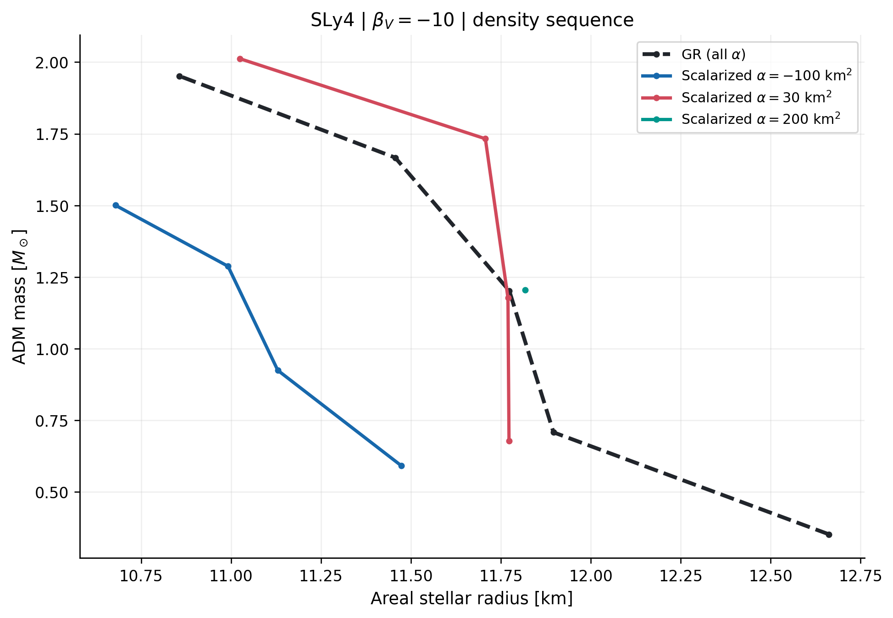

# Scalarized neutron stars — Ricci + Gauss–Bonnet (STGB)

A Python research implementation for exploratory, static, spherically symmetric neutron stars in quadratic Ricci-scalar and Gauss–Bonnet scalar–tensor gravity. It loads tabulated equations of state, integrates GR and fully coupled scalarized stellar configurations, and constructs seven diagnostic figure families. Developed for a neutron-star thesis; **not a peer-reviewed or production-validated physics code**.

The model uses the **canonical field normalization** :

\[
S=\int d^4x\sqrt{-g}\left[\frac{R}{2\kappa}-\frac12(\nabla\phi_V)^2-\frac{\beta_V}{4}R\phi_V^2+\frac{\alpha}{2}\mathcal{G}\phi_V^2\right]+S_m,\quad \kappa=8\pi.
\]

Here `beta` = \(\beta_V\) is dimensionless; `alpha` is in km². The thesis's earlier fields relate via \(\phi_\mathrm{thesis}=\sqrt{16\pi}\phi_V\), \(\beta_V=2\beta_\mathrm{thesis}\), and \(\eta=4\alpha\). The derivative coupling and bare scalar mass are set to zero.



*Illustrative quick-mode output only; do not cite as a validated benchmark.*

## Run on Windows (simplest)

1. Install Python 3.10 or newer with `py` available.
2. Extract this repository to a **folder you can read**; do not run it from inside the ZIP.
3. Double-click `INSTALL_WINDOWS.bat` once.
4. Double-click `RUN_WINDOWS.bat`. It generates the seven figure families in **quick** quality, opens the Matplotlib figures for inspection, and **does not save until you approve**.
5. Close the plot windows after inspection; type `y` at the terminal's save prompt. The default output is `Documents/STGB_Results`. If unwritable, it tries your home directory and then the system temporary directory, prints the actual location, and never writes into protected Python or program directories.

If no figures open, install a Python distribution with Tk/TkAgg support, avoid `MPLBACKEND=Agg`, and launch from Command Prompt or a VS Code terminal. Interactive preview requires a desktop GUI.

## Command-line examples

```bash
python -m pip install -r requirements.txt
python run.py --quality quick --figures all --eos SLy4 --beta -10 --alpha 30
python run.py --quality thesis --figures all --eos APR --beta -10 --alpha 30
python run.py --figures 1,6 --eos DD2 --alpha 100 --beta -10 --preview-only
python run.py --figures 2,3,5 --quality quick --save
python run.py --figures 7 --quality thesis --no-show --save --output ./results
python run.py --figures 2,3 --sequence-alphas=-200,0,100,200 --sequence-points 21
python run.py --figures 4 --coupling-alphas=-200,-100,0,100,200
python -m pytest -q
```

An editable install is also possible: `python -m pip install -e .`, then `stgb-plots --figures 1,6`.

The **default** behavior is always *compute → display all requested plots → close the plot windows → ask whether to save*. `--save` requests saving after preview. `--preview-only` disables saving. For automated/headless jobs use `--no-show --save`. Data and figure files are written only when saving is explicitly requested or approved. `--quality thesis` runs denser, substantially slower parameter/central-density grids; the plots should still be treated as preliminary until independent benchmark convergence is shown.

To change the scanned parameter ranges without editing source, use `--sequence-alphas`, `--coupling-alphas`, `--threshold-alphas`, `--density-low`, `--density-high`, `--sequence-points`, `--beta-min`, and `--beta-max`. The required comma-separated lists can begin with a negative number when using the `--option=-200,-100,0` syntax.

## Figure plan and conventions

| # | File prefix | Content | Baseline / format |
|---|---|---|---|
| 1 | `01_effective_mass_and_scalar` | Two panels: contributions to \(m_\mathrm{eff}^2\) on **GR** geometry; nonlinearly scalarized \(\phi_V(r)\) | GR zero-field dashed; stellar surface dotted |
| 2 | `02_mass_radius` | \(M(R)\) sequences for one EOS, several \(\alpha\) | **Dashed black GR**; scalarized solid colored curves |
| 3 | `03_scalar_charge` | \(|Q|/M\) versus \(M\) at several \(\alpha\) | GR \(Q=0\) dashed black |
| 4 | `04_alpha_dependence` | \(\Delta M/M_\mathrm{GR}\) and \(|Q|/M\) versus \(\alpha\) at **fixed** central density | GR zero baseline dashed |
| 5 | `05_six_eos_mass_radius` | **2×3 small multiples**, one for each EOS | Same \(\alpha,\beta_V\), same axes; black dashed GR vs colored scalarized |
| 6 | `06_interior_structure` | Two panels: \(p(r)\), \(\epsilon(r)\) | GR dashed black; scalarized solid, same central density |
| 7 | `07_linear_zero_mode_threshold` | Fundamental scalar **zero-mode threshold** \(\beta_{\rm crit}(\alpha)\) on GR background | Only computed roots; *NOT* a map of nonlinear solution existence or stability |

**Plot interpretation rules:**

- The GR branch always exists in this quadratic model; the scalarized branch is an **additional** possible solution, not a replacement for all stars.
- A missing point means *no verified node-zero solution detected by this finite positive-\(\phi_c\) shooting scan* — not mathematical proof of non-existence. Failed points are not connected; beware sparse-grid apparent boundaries.
- Only the node-zero branch is graphed in these figures; higher-node solutions may exist but are outside this visualization.
- \(m_\mathrm{eff}^2<0\) locally is not a sufficient condition for scalarization. Figure 7 uses the actual static scalar eigenmode equation on a GR star; a zero-mode *threshold* is not a nonlinear domain-of-existence or dynamical-stability map.
- In figure 4, \(\Delta M=M_\mathrm{scalar}-M_\mathrm{GR}\) compares the **same central total energy density and EOS**, not equal baryonic mass.
- Scalar charge \(Q\) is the coefficient of \(1/r\) in the canonical-field asymptotic expansion; \(M\) is the ADM mass estimated from the exterior. Figure 3 plots the **absolute** charge ratio for readability; signs remain in the CSV.

## Units, EOS format, scientific data issues

Required CSV fields are `rho_g_cm-3`, `epsilon_MeV_fm-3`, and `P_MeV_fm-3`; `rho_g_cm-3` is **total energy-equivalent density** \(\epsilon/c^2\), *not baryonic density*. SI/CGS EOS data are converted to geometrized km units internally. Units and conventions are reported in `run_metadata.json`.

The supplied log-polynomial fitted formulas are **not used**, because their listed relative errors can be large. We use shape-preserving PCHIP on the standardized tables. **FSUGarnet, G3, and IOPB contain small lower-density pressure reversals**; these points are excluded with warnings, not silently fixed. APR has localized superluminal secant slopes and needs a separate physical validity assessment. The stellar surface is defined at the **minimum tabulated positive pressure**, so its radius can differ slightly from the mathematical \(p=0\) surface.

Data provenance and redistribution rights have not been verified: **before publishing to GitHub, inspect `data/README.md` and remove any data whose public redistribution rights are unknown.** The MIT license applies to author-written code, not automatically to EOS data.

## Verification and limitations

Implemented independent tests include the GR-connected \(rr\) root, comparison between the GR solver and \(\phi_V=0\) in the modified solver, the Schwarzschild exterior Gauss–Bonnet invariant, a light-SLy linear zero-mode threshold, node-zero shooting, and line-break logic for missing numerical branches. The current SLy4 tabulation gives about **1.138 solar masses** in GR at \(8.1\times10^{14}\) g/cm³. The published light-SLy case is described as about **1.12 solar masses**; these are not an exact match, likely reflecting EOS representation and/or table choices. Full numerical reproduction and independent convergence studies remain necessary before quantitative thesis claims.

Conventions and methodological reference: Ventagli, Antoniou, Lehébel, Sotiriou (2021), DOI [10.1103/PhysRevD.104.124078](https://doi.org/10.1103/PhysRevD.104.124078).

**Known limitations:** approximate EOS surface; finite-radius asymptotic fits; center-root branch tracking near singular/disconnected regions; incomplete sampling of central-field roots; no radial stability proof; no causality/composition audit of user-supplied EOS; no observational likelihoods; potential missed scalarized branches at grid edges; no automatic adaptive parameter continuation.

## Repository layout

```text
STGB-Neutron-Stars/
├── run.py                     # No-install entry point
├── RUN_WINDOWS.bat            # Interactive preview then save prompt
├── INSTALL_WINDOWS.bat
├── pyproject.toml             # Editable package + CLI command
├── requirements.txt
├── src/stgb/
│   ├── gravity.py             # Published rr branch and radial equations
│   ├── eos.py                 # Tabulated EOS with validation
│   ├── stellar.py             # GR, nonlinear scalar shooting, diagnostics
│   ├── onset.py               # Linear GR zero-mode threshold
│   ├── analysis.py            # Physics datasets, cache, parameter scans
│   ├── figures.py             # Seven figure designs
│   └── cli.py                 # Preview before saving; output fallback
├── tests/                     # Small physics and plotting unit tests
├── data/                      # EOS tables (audit licensing before public release)
├── docs/                      # Numerical verification and figure interpretation notes
└── LICENSE                    # Software only
```

Saved runs create uniquely timestamped output subfolders with `figures/*.png` and `*.pdf` (vector), `data/*.csv` where applicable, and an audit-ready `run_metadata.json` with input parameters and warnings.
